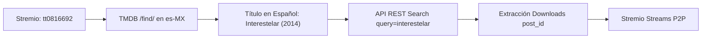

# 🚀 GUÍA TÉCNICA: ADDON STREMIO (RAAVA STR)

Este documento detalla la arquitectura, ingeniería inversa, integración con TMDB, extracción de Torrents P2P, inyección de trackers y despliegue del addon **RAAVA STR** para Stremio.

---

## 1. 🏗️ Arquitectura del Addon

El addon está construido sobre **Node.js** utilizando el estándar oficial de Stremio (`stremio-addon-sdk`) y montado sobre un servidor **Express**:

```text
raava-stremio/
├── addon.js                  <-- Definición del manifiesto y router de streams
├── server.js                 <-- Servidor Express, router Stremio y Landing Page
├── package.json              <-- Dependencias (express, axios, stremio-addon-sdk)
├── render.yaml               <-- Configuración para despliegue en la nube
└── services/
    ├── tmdb.js               <-- Resolución de títulos de IMDb a Español Latino
    ├── hackstore.js          <-- Consulta a API interna y generación de streams
    └── tracker.js            <-- Consulta no bloqueante de trackers y enjambre
```

---

## 2. 🧠 El Algoritmo de Mapeo de Títulos (IMDb -> Español Latino)

Stremio solicita streams utilizando códigos IMDb (ejemplo: `tt0816692` o `tt11198330:2:8`). Dado que los catálogos en español no indexan por código IMDb en inglés, implementamos un puente de conversión ultrarrápido:



1. **Consulta TMDB:**  
   Se utiliza el endpoint `/find/{imdbId}?external_source=imdb_id&language=es-MX` con una clave API global.
2. **Normalización:**  
   Se extrae tanto el título oficial en español latino como el título original en inglés y el año de lanzamiento.
3. **Caché en Memoria:**  
   Cada consulta se guarda en un `Map()` para que las peticiones repetidas respondan en **0 milisegundos**.

---

## 3. ⚡ Torrents P2P Limpios (Sin Acortadores de Publicidad)

En la interfaz web de los sitios de películas, al pulsar "Descargar Torrent" se envían a los usuarios por 3 o 4 páginas de acortadores con captchas y anuncios invasivos.

**El Descubrimiento Clave:**  
Al consultar la API interna:
```text
GET https://hackstore2.com/api/rest/downloads?post_id={id}
```
La API devuelve directamente el objeto con el enlace magnético puro:
```json
{
  "server": "Utorrent",
  "quality": "WEB-DL 1080p",
  "size": "2.85 GB",
  "lang": "Latino - Inglés",
  "format": "MKV",
  "url": "magnet:?xt=urn:btih:6b9546d1...&tr=..."
}
```

### Extracción del InfoHash e Inyección de Trackers:
1. Se extrae el hash SHA1 de 40 caracteres (`xt=urn:btih:([a-fA-F0-9]{40})`).
2. Se inyectan trackers públicos de alta velocidad (`opentrackr`, `demonii`, `openbittorrent`, etc.) en la propiedad `sources: [...]` para que Stremio comience a descargar inmediatamente a través de múltiples pares y la red global DHT.

---

## 4. 🏷️ Presentación Visual en Stremio

El stream se presenta sin alusiones directas ni corchetes molestos:

```text
RAAVA STR
1080p
------------------------------------------------
🎬 WEB-DL 1080p (MKV)
👤 Swarm DHT | 💾 2.19 GB | 🔊 Latino Dual 5.1
⚡ P2P Direct Stream
```

- **Nombre:** `RAAVA STR\n${calidad}`
- **Descripción:** Calidad de encode, códec, estado del enjambre DHT, peso del archivo y canales de audio.

---

## 5. 🛠️ Cómo Probar en Local

1. Abre una terminal en la carpeta:
   ```cmd
   cd raava-stremio
   ```
2. Instala dependencias:
   ```cmd
   npm install
   ```
3. Inicia el servidor:
   ```cmd
   npm start
   ```
4. En Stremio:
   Pega en la barra **"Buscar complementos"** (arriba a la derecha):
   ```text
   http://127.0.0.1:7000/manifest.json
   ```

---

## 6. 🌐 Despliegue Gratuito 24/7 en la Nube (Render.com)

Para que el addon funcione en cualquier momento desde tu TV, celular o PC sin encender la computadora:

1. Crea un repositorio independiente en GitHub (por ejemplo `raava-stremio`) y sube esta carpeta.
2. Ve a [Render.com](https://render.com/) e inicia sesión con tu GitHub.
3. Haz clic en **New +** > **Web Service**.
4. Conecta tu repositorio.
5. Parámetros de configuración:
   - **Environment:** `Node`
   - **Build Command:** `npm install`
   - **Start Command:** `node server.js`
   - **Plan:** Free ($0)
6. Haz clic en **Create Web Service**.
7. Render te dará una URL HTTPS pública (ejemplo: `https://raava-str.onrender.com`).
8. Pega `https://tu-servicio.onrender.com/manifest.json` en Stremio o haz clic en "Instalar" desde la página web.
